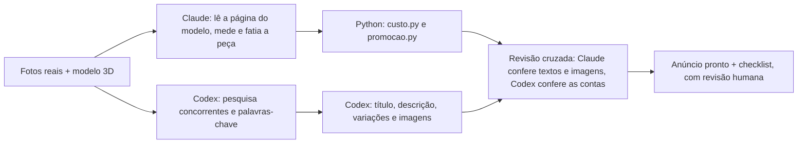
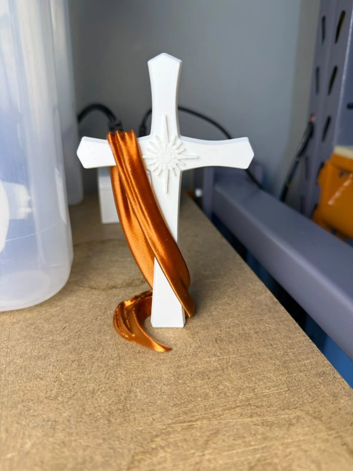

# 🛍️ shopee-anuncio-ia

**Fluxo com IA para transformar uma peça impressa em 3D em um anúncio completo da Shopee.** A partir de fotos e referências, ele gera imagens de catálogo, título, descrição, variações e checklist, e calcula custo e preço.

> Projeto pessoal criado para o meu negócio de impressão 3D. Foi testado com 2 produtos reais.

---

## O problema

Na minha operação, criar cada anúncio exigia várias tarefas manuais:

1. Pesquisar concorrentes e palavras-chave.
2. Medir e fatiar a peça para saber o peso e o tempo de impressão.
3. Calcular o custo de produção e o preço com promoções e taxas da Shopee.
4. Escrever título, descrição, ficha técnica e variações.
5. Produzir fotos de catálogo, já que a foto tirada na bancada não serve como capa.

## A solução

Um fluxo em que **dois agentes de IA dividem o trabalho em paralelo** e **um revisa o outro**. Todos os números saem de scripts em Python, não da IA.



| Etapa | Quem faz | Saída |
|---|---|---|
| Pesquisa de mercado | Codex | `PESQUISA_CODEX.md` |
| Medidas, fatiamento e custo | Claude + scripts Python | peso, tempo, custo e preço |
| Texto do anúncio | Codex, seguindo um método de copy para Shopee | título (menos de 100 caracteres), descrição, ficha técnica, variações |
| Imagens | Codex (gerador de imagens), partindo da **foto real** | capa, foto ambientada e detalhes |
| Revisão cruzada | Claude ⇄ Codex | lista do que está OK e do que está errado, com sugestões |
| Aprovação e publicação | Eu | anúncio no ar |

## Antes e depois: Kit de Natal (Cruz com véu)

| Entrada: foto real, tirada na bancada | Saída: foto de catálogo | Saída: capa do kit | Saída: foto ambientada |
|---|---|---|---|
|  |  |  |  |

A foto real é a fonte da verdade. Ela mostrou que o filamento "dourado" na verdade sai **cobre**, e o texto do anúncio inteiro foi corrigido por causa disso.

## Lições e limites (o que aprendi testando)

- **A IA redesenha a peça.** Pedir "só troca o fundo" não preserva os pixels: o gerador reinterpreta detalhes. Por isso toda imagem passa por conferência contra a foto real, e algumas foram **reprovadas** (por exemplo, uma imagem com pés de varal genéricos e uma peça que não existe).
- **A IA não faz conta.** Custo e preço vêm de scripts determinísticos, com arredondamento em `Decimal` e validação das entradas.
- **Não inventar.** Não entram termos como "antiderrapante" ou "universal" sem comprovação. O fluxo também checa a **licença comercial** de cada modelo 3D antes da venda.
- **Ferramentas falham.** O Codex não conseguia abrir o MakerWorld, então o Claude passou a ler a página antes e entregar a ele os dados já confirmados.

## Estrutura

```
scripts/
  custo.py          # custo de produção: material, energia, desgaste da impressora, embalagem e Ads
  promocao.py       # preço âncora, oferta relâmpago, cupom, comissão e preço mínimo sem prejuízo
  fatiar_orca.py    # fatia STL/3MF no OrcaSlicer pela linha de comando e devolve peso e tempo
  stl_dims.py       # mede as dimensões e o volume de um STL binário
  exemplo_pecas.json
prompts/
  prompts_codex.md      # modelos de prompt para imagens e revisão
  template_anuncio.md   # estrutura do anúncio final
exemplos/kit-natal/     # antes e depois
```

## Como rodar os cálculos

```bash
python scripts/custo.py scripts/exemplo_pecas.json
python scripts/promocao.py --item "1 un|final=29.90|custo=8" --relampago 25 --cupom 3
```

Os scripts só usam a biblioteca padrão do Python. O `fatiar_orca.py` precisa do [OrcaSlicer](https://github.com/SoftFever/OrcaSlicer) instalado.

## Tecnologias

Python · Claude (Claude Code) · Codex / ChatGPT · geração de imagem com IA · OrcaSlicer CLI · Markdown

---

Feito por **Arthur Rodrigues de Oliveira Silva** · [LinkedIn](https://www.linkedin.com/in/arthur-rodrigues-de-oliveira-silva-1552a4164/)
